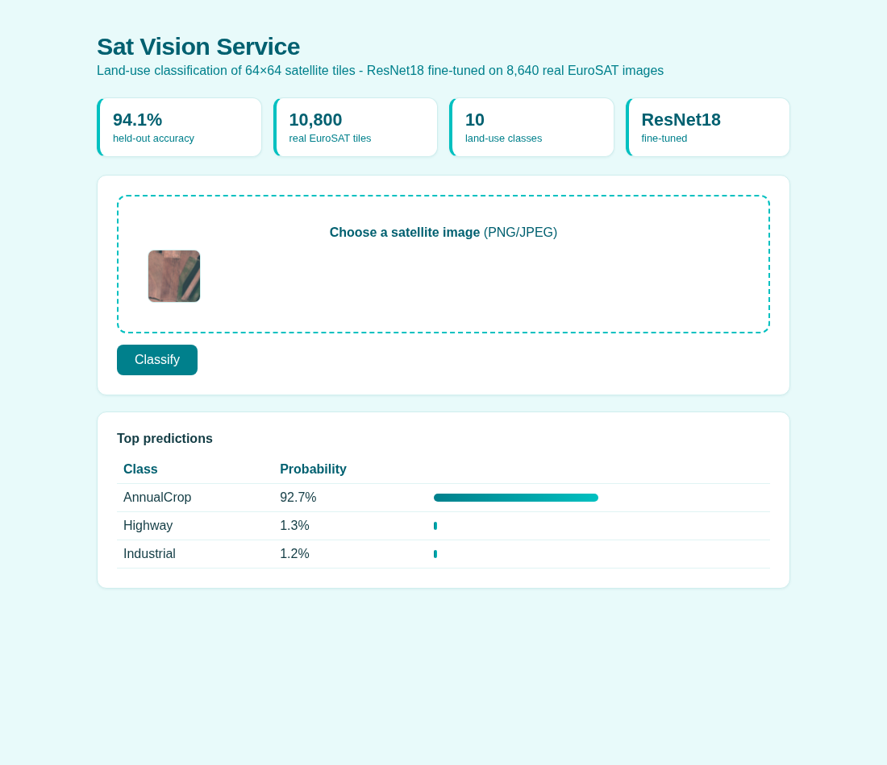

# sat-vision-service

Satellite land-use classification as a deployable service: ResNet18 transfer learning on
real EuroSAT imagery, a FastAPI inference API with an upload web UI and a Postgres
prediction log. Dockerized and deploy-ready.

Built with AI pair-programming (Claude). All numbers below are real outputs of the
commands shown, not targets.

## Screenshot

Real capture of the app running locally: an uploaded satellite tile classified with its top predictions.

## Dataset
EuroSAT RGB (Sentinel-2, 64x64 tiles, 10 land-use classes), mirrored at
huggingface.co/datasets/blanchon/EuroSAT_RGB. The mirror ships a train and a test parquet;
this repo pools the tiles it uses (10,800) and re-splits them itself: a stratified 80/20
split with a fixed seed, giving 8,639 train / 2,161 held-out tiles. It is not the official
test split. Download with `python scripts/download_data.py`.

## Real results (held-out 2,161 tiles, CPU)
- final model (three-phase fine-tune of ResNet18): **94.1%** accuracy, 10 classes (chance = 10%)
- head-only baseline (frozen backbone, 4 epochs): 83.9%
- weakest classes: Highway 88.4% and River 88.0% recall; strongest SeaLake 99.2%
- full history and confusion matrices: `results/metricsA.json`, `metricsB.json`, `metricsC.json`; per-class table in RUN-RESULTS.md

## Run locally (no Docker)
    pip install -r requirements.txt
    python scripts/download_data.py
    python -m src.train            # trains, evaluates, writes results/
    pytest -q                      # 3 tests (2 skip when data or weights are absent)
    uvicorn src.api:app --port 8000
    # open http://localhost:8000/ for the upload UI

## Run with Docker (Postgres included)
    docker compose up --build     # api on :8000, postgres 16 with migrations applied

Without Docker the API logs predictions to SQLite (`data/app.db`); with compose it uses
PostgreSQL (`DATABASE_URL`).

## API
    POST /predict   image file -> top-3 classes with probabilities (logged)
    GET  /history   latest logged predictions
    GET  /metrics   training metrics
    GET  /health

## Honest limits
- The same 2,161-tile held-out split was used to watch accuracy every epoch, to choose the
  three-phase recipe (which layers to unfreeze, learning rates, epochs) and to save a "best"
  checkpoint. There is no separate validation split, so 94.1% is slightly optimistic. The
  reported figure is the final-epoch model, not the best epoch (94.3%).
- CPU-only training with a short schedule. Published GPU fine-tunes of ResNet-18 on EuroSAT
  reach about 97-98% with longer schedules and heavier augmentation.
- 64x64 tiles are small; production satellite pipelines usually work on larger scenes.

## Stack
Python, PyTorch (ResNet18), FastAPI, vanilla-JS upload UI, PostgreSQL (Docker) / SQLite,
pytest, GitHub Actions CI.

## Results

Held-out accuracy: **94.1%** on 2,161 held-out tiles (10-class EuroSAT; head-only baseline 83.9%). Per-class recall and full details: RUN-RESULTS.md.

